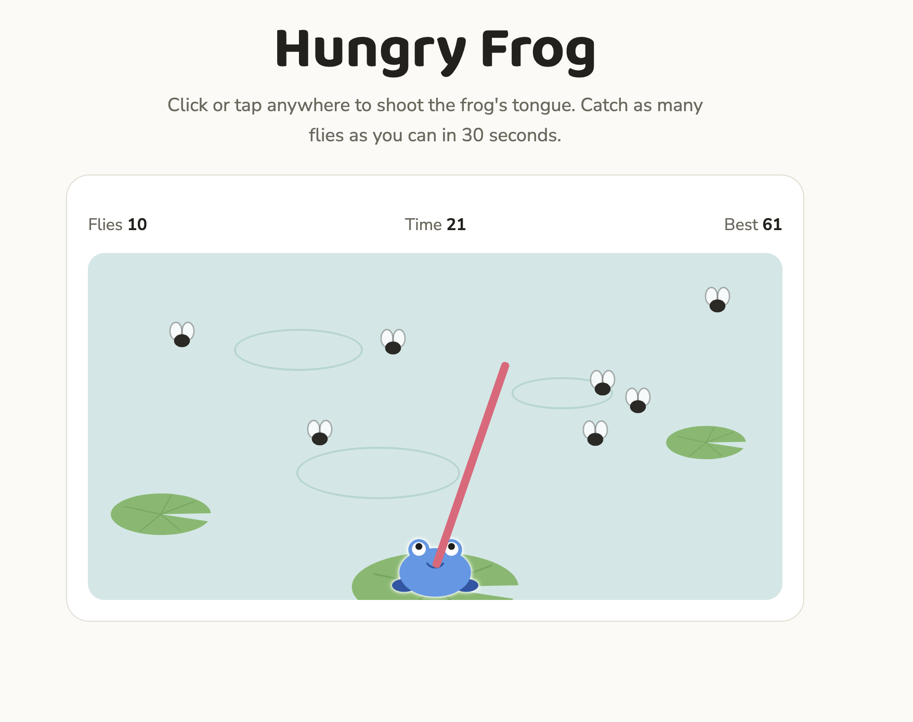

# Hungry Frog 🐸

A browser game where you feed a hungry frog! Catch as many flies as you can in 30 seconds 🪰

**[▶ Play it here](https://dinaongit.github.io/the-hungry-frog-game/)**

## How to play

Use the frog's tongue to catch the flies buzzing over the pond.

- **Mouse or touch:** click or tap anywhere in the pond to shoot the frog's tongue there.
- **Keyboard:** press Tab to focus the pond, move the aim with the arrow keys, and press Space or Enter to shoot.

Your best score is saved in your browser, so you can try to beat it next time.

## Play on your phone

Open the [game link](https://dinaongit.github.io/the-hungry-frog-game/) on your phone and add it to your home screen. It then opens like an app, with its own frog icon.

- **iPhone (Safari):** tap Share, then **Add to Home Screen**
- **Android (Chrome):** tap the ⋮ menu, then **Add to Home screen** or **Install app**

## Features

- **30-second rounds** with a live score and timer
- **Best score saved** in your browser with localStorage, so it's still there after a refresh
- **The frog changes color** as you catch more flies: blue, pink, yellow, diamond, gold and finally holographic at 50
- **Works on desktop and phones**, and can be added to your home screen
- **Accessible:** play with the keyboard, screen readers announce the score and time, and flies move slower for people who turn on "reduce motion"

## Built with

- **HTML** – semantic structure and ARIA labels for screen readers
- **CSS** – custom properties (variables), a keyframe animation for the flies, and media queries for phones
- **JavaScript** – no frameworks: DOM events, timers (`setInterval`, `setTimeout`) and `localStorage`
- **Google Fonts** – Baloo 2 and Nunito Sans
- **GitHub** – Projects board for planning, pull requests for code review, and Pages for hosting

## Team

Made as a team project at Hyper Island in 2026 by:

- Konstantina Migadaki
- Margarita Nikulina
- Faryal Zahid
- Ayodeji Dairo

The original team repo is [filisa/team-4-fun-game-project](https://github.com/filisa/team-4-fun-game-project). This is my copy, where I keep improving the game.

### What I built

- The page layout: game container, stats bar and pond, plus the lily pads and ripples
- The fly counter in the stats bar
- The welcome screen that starts the game
- The 30-second timer
- The end screen and Play again
- A fix for the best score, which compared text instead of numbers
- The white edge around the frog, so every frog color stands out from the lily pad
- A CSS clean-up: variables at the top, duplicates removed, media queries grouped

## License

[CC0 1.0](LICENSE): free to use, copy and change, no permission needed.
